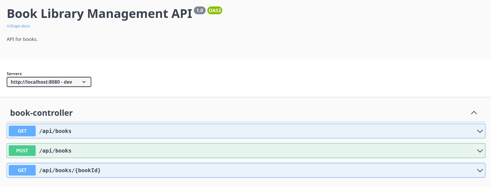
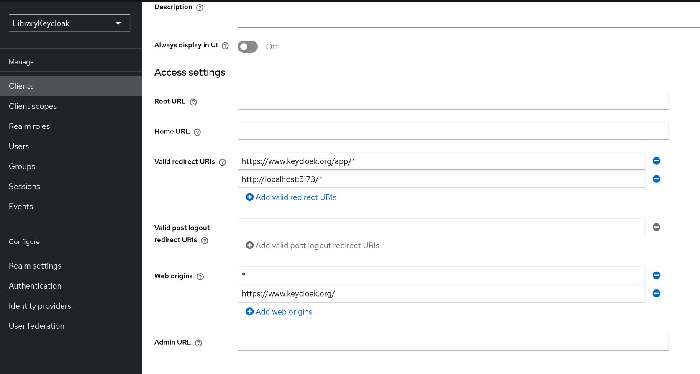
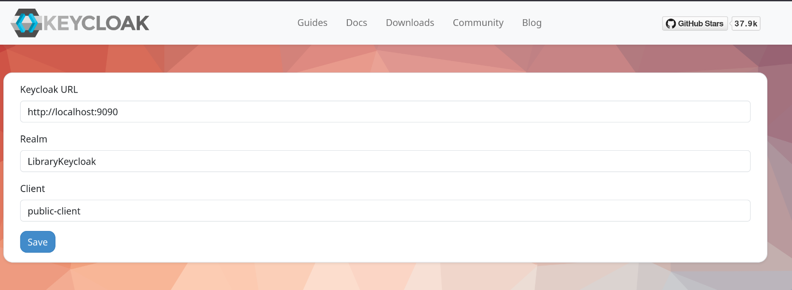
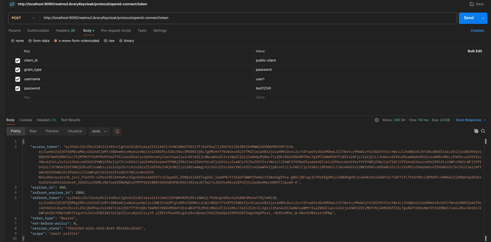
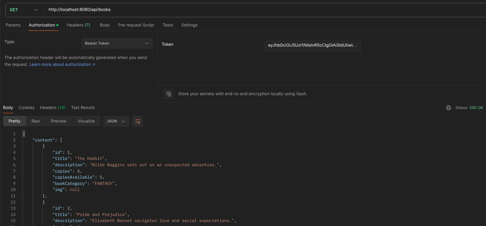

`docker-compose up`

`mvn spring-boot:run`

- Keycloack console: http://127.0.0.1:9090/admin/master/console/ (admin:admin)
- Swagger UI: http://localhost:8080/swagger-ui/index.html



### Keycloack setup


**Steps**:
<details>
<summary>realm-export.json</summary>

```
Import realm-export.json from Keycloak admin dashboard (Action > Partial import)
```

</details>

1. Create a realm (eg. *LibraryKeycloak*)
2. Create a user (Email verified On, Temporary Password off)
3. Create client:
   * Client type: **OpenID Connect**
   * Client ID: eg. *public-client*
   * Authentication flow: **Standard flow** & **Direct access grant**
   * Valid redirect URIs:
   

Test local running environment of Keycloak:

[keycloack.org/app](https://www.keycloak.org/app/)


After we will get redirected to https://www.keycloak.org/app/?url=http://localhost:9090&realm=LibraryKeycloak&client=public-client

#### Test with Postman

Calling the Keycloak app to fetch the authentication token for auth a user
**POST** http://localhost:9090/realms/LibraryKeycloak/protocol/openid-connect/token



**access_token**: JWT used to authenticate API requests.

**refresh_token**: Used to obtain a new access token. 
  * there's another endpoint where if the _access_token_ expires, you can submit the _refresh_token_ to keycloak in exchange 
for another _access_token_ (therefore the user doesn't resign-in but the access_tokens are always changing)

**expires_in**: 300: Access token expires after 5 minutes.

**refresh_expires_in**: 1800: Refresh token expires after 30 minutes.

**token_type**: Bearer: Send the access token using the Bearer authentication scheme.

**scope**: email profile: Granted scopes.

**Authenticated request:**

Get the access token from the Keycloak endpoint above and added it to the requests as Bearer token:

